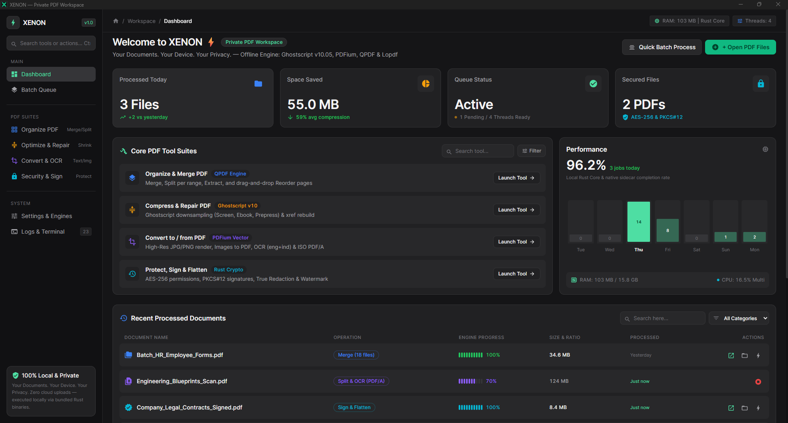
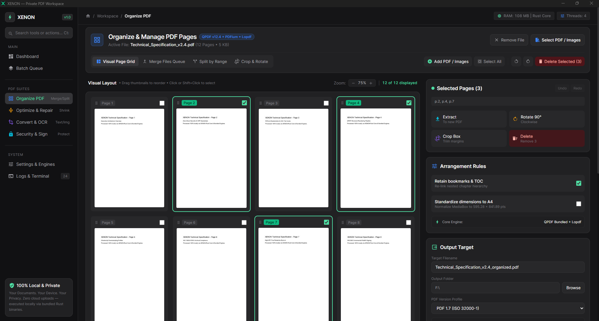

# XENON — Private PDF Workspace

**Your Documents. Your Device. Your Privacy.**

XENON is a 100% offline, open-source desktop PDF workstation built with **Tauri v2**, **React**, **TypeScript**, and **Rust**. Every PDF processing engine, OCR language dataset (`eng` + `ind`), and ICC color profile runs strictly on your local machine — zero cloud uploads, zero telemetry, and zero account requirements.

---

## Screenshots

### Dashboard & Analytics


### Organize & Manage PDF Pages


---

## Key Features & Tool Suites

- **Organize & Manage PDF Pages**
  - Visual Page Grid (`@dnd-kit` drag-and-drop reordering, multi-select, zoom controls, Undo/Redo)
  - Independent Merge Files Queue with drag-to-reorder assembly
  - Split & Extract (`Range`, `Extract Selected`, `Every N Pages`, `Burst`), plus visual CropBox & Rotate
- **Optimize & Repair**
  - Ghostscript-backed compression (`Screen`, `Ebook`, `Printer`, `Prepress`, or custom DPI & JPEG quality) with live stream size estimation
  - Corrupt `xref` table & object reconstruction, XMP/hidden metadata sanitization, and Fast Web View linearization
- **Convert, OCR, Compare & AcroForm**
  - High-DPI PDF ↔ Image conversion (`PNG`, `JPEG`, `WebP`, `TIFF`, `BMP`)
  - Searchable OCR PDF (`eng` + `ind`) & ISO 19005 PDF/A archival conversion (`pdfa-1b`, `pdfa-2b`, `pdfa-3b`)
  - Side-by-side PDF revision comparison (Visual Pixel Diff heatmap + Semantic Text Diff)
  - Interactive AcroForm field creator, drag placement, editor, and flattening
- **Security, Digital Sign & Watermark**
  - AES-256 / AES-128 & PDF 2.0 UTF-8 password encryption, permission controls, and PDF unlock
  - Interactive Visual Signature (`PNG` / `JPG` drag-to-move & corner-resize)
  - Incremental PKCS#12 (`.p12` / `.pfx`) CMS cryptographic signing
  - Text & Image Watermarking with live preview and layer flattening
  - **True Redaction**: manual draw/move/resize redaction boxes + cross-page auto-redact (`Text`, `Phone`, `Email`, `Digits/NIK`) with 300 DPI pixel burn-in
- **Batch Queue & Process Control**
  - Real-time progress tracking with OS-level process tree control (`Pause`, `Resume`, `Cancel`) via Win32 Job Objects / Unix Process Groups

---

## Tech Stack & Architecture

### 1. Application Layers

| Layer | Technologies | Responsibilities |
| :--- | :--- | :--- |
| **Desktop Shell** | **Tauri v2** (Rust) | Sandboxed native window, OS file dialogs, desktop notifications, custom `xenon://` protocol |
| **Frontend UI** | **React 19**, **TypeScript**, **Tailwind CSS**, **Zustand**, **@dnd-kit** | Obsidian Slate workspace, code-split tool suites, drag-and-drop page organizer, interactive redaction & signature canvases |
| **Local Persistence** | **SQLite** (`rusqlite` with WAL mode) | Job execution history, space-saved analytics, rolling 7-day throughput telemetry, and persistent settings |
| **Process Control** | **Tokio** + `windows-sys` / `libc` | Async job execution, real-time log streaming (`engine-log-line`), OS process suspension & termination |

### 2. Core Bundled Engines (`0` External Dependencies)

| Engine | Integration | Primary Capabilities |
| :--- | :--- | :--- |
| **PDFium (`pdfium-render`)** | Native Rust FFI (`pdfium.dll`) | Sub-pixel page tile rendering (`xenon://` LRU cache), PDF → Images, character-level text bounding lookup, 300 DPI True Redaction burn-in |
| **QPDF (`qpdf`)** | Bundled Native CLI (`v12.4`) | Page reorder/merge/split/crop, Fast Web View linearization, structural `xref` recovery, AES-256/128 encryption & decryption |
| **Ghostscript (`gswin64c`)** | Bundled Native CLI (`v10.05`) | Stream downsampling & compression, ISO PDF/A archival output, embedded Tesseract OCR (`eng` + `ind`) |
| **Lopdf & Rust Crypto** | Pure Rust + `cms` / `p12` / `x509-cert` | Stream inspection, size estimation, XMP cleanup, AcroForm widget generation/flattening, visual stamps, watermarks, PKCS#12 CMS incremental signing |

### 3. Security & Reliability Design

- **Atomic File Writes (`.part`)**: Every output is written to a temporary `.part` file and atomically promoted upon completion; interrupted `.part` artifacts are automatically swept on startup or cancellation.
- **Binary Integrity Verification**: Bundled engines are verified at startup and in Settings against SHA-256 checksums stored in `src-tauri/resources/integrity-manifest.json`.
- **Zero Network Footprint**: Built strictly for local execution with no outbound API calls or cloud processing.

---

## Installation

### End Users (Pre-built Installer)

1. Go to the [**GitHub Releases**](../../releases) page and download the installer for your operating system:
   - **Windows (x64):** `XENON_x.x.x_x64-setup.exe` (NSIS Installer) or `XENON_x.x.x_x64_en-US.msi` (MSI Installer)
   - **macOS (Apple Silicon / ARM64):** `XENON_x.x.x_aarch64.dmg`
   - **Linux (x64):** `XENON_x.x.x_amd64.AppImage`, `XENON_x.x.x_amd64.deb`, or `.rpm`
2. Run the installer and launch **XENON** — all PDF engines (`PDFium`, `QPDF`, `Ghostscript` + Tesseract OCR, and `tessdata`) are bundled directly inside the application.
3. **Security prompt notes (unsigned open-source builds):**
   - **Windows SmartScreen:** Click **More info → Run anyway** after verifying the release checksum.
   - **macOS Gatekeeper:** Because open-source builds are not notarized with an Apple Developer ID, drag XENON to Applications and run `xattr -cr /Applications/XENON.app` (or allow in **System Settings → Privacy & Security → Open Anyway**) if macOS reports the app cannot be verified.

---

### Developers (Build from Source)

#### Prerequisites
- **Node.js 20+** and **npm**
- **Rust** stable toolchain (`rustup`, `cargo`, `rustc`)
- **Tauri v2** system prerequisites for your OS ([Tauri Prerequisites Guide](https://v2.tauri.app/start/prerequisites/))

#### Setup & Commands

```bash
# 1. Install frontend dependencies
npm install

# 2. Run the desktop application in development mode
npm run tauri dev

# 3. Typecheck and build the frontend bundle
npm run build

# 4. Run Rust core, engine, and integrity unit tests
npm run test:rust

# 5. Regenerate SHA-256 binary integrity manifest (if bundled binaries change)
npm run verify:integrity

# 6. Build the production desktop installer (.msi / .exe)
npm run tauri build
```

---

## Keyboard Shortcuts

| Shortcut | Scope | Action |
| :--- | :--- | :--- |
| `Ctrl + O` | PDF Tool Suites | Open PDF / image files for the active suite |
| `Ctrl + K` | Global | Focus quick command search in sidebar |
| `Ctrl + L` | Global | Toggle Logs & Terminal drawer |
| `Ctrl + ,` | Global | Open Settings & System Preferences |
| `Ctrl + E` | Organize PDF Grid | Execute & Export current page arrangement |
| `Ctrl + Z` / `Ctrl + Shift + Z` (`Ctrl + Y`) | Organize PDF Grid | Undo / Redo page actions |
| `Ctrl + A` | Organize PDF Grid | Select all pages |
| `Ctrl + R` | Organize PDF Grid | Rotate selected pages 90° clockwise |
| `Delete` / `Backspace` | Organize PDF Grid | Remove selected pages from workspace |

---

## License

Licensed under **GNU AGPL-3.0-or-later** (compatible with bundled Ghostscript).
